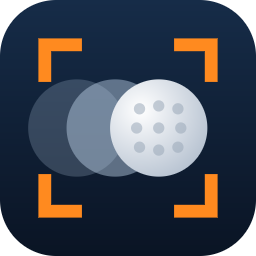
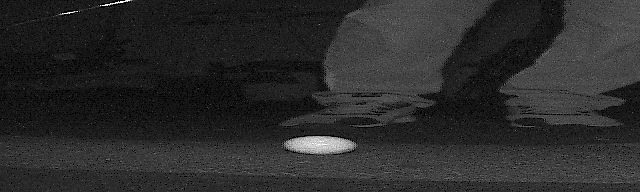

# square_impact

[](https://github.com/moexx399/square_impact/actions/workflows/ci.yml)
[](https://github.com/moexx399/square_impact/actions/workflows/build-exe.yml)
[](https://github.com/moexx399/square_impact/releases)
[](LICENSE)


**Instant high-speed replays from the Square Omni launch monitor's own cameras.**

The Square Omni films every shot at ~500 fps with two internal cameras, but it
never shows you that footage. square_impact pulls the frames around impact
straight out of the camera board's memory over USB, a few seconds after each
shot, and shows them as a slow-motion clip. You can watch it in a desktop
viewer or as a pop-up overlay in OBS.

<p align="center">
  
  <br>
  <sub>A real pitch, exactly as the overlay shows it: 37 frames from the Omni's
  launch camera at 500 fps (74 ms of real time), slowed down about 17×, pausing
  on the moment of contact. The Omni measured it at 17.7 m/s ball speed, 38.7°
  launch and 4,620 rpm of spin.</sub>
</p>

> **Use at your own risk. This software comes with no warranty of any kind.**
> It's unofficial and not affiliated with or endorsed by Square. It reads the
> device through its debug interface and **never writes anything to it** (see
> [Read-only by design](#read-only-by-design)), but it still talks to the
> hardware in ways Square doesn't support, and a firmware update could change
> any of the internals it relies on. See [Disclaimer](#disclaimer) and
> [License](#license).

**Contents:** [Quick start](#quick-start) · [OBS overlay](#obs-overlay-options) ·
[Commands](#commands) · [Output](#output) · [How it works](#how-it-works) ·
[Building](#building-the-executables) · [Known limits](#known-limits) ·
[Contributing](#contributing) · [Changelog](CHANGELOG.md)

---

## Quick start

**macOS and Linux, with [Homebrew](https://brew.sh):**

```bash
brew install moexx399/tap/square_impact
```

Homebrew installs the right build for your computer, and `brew upgrade` keeps it
up to date (`square_impact update` points you there). Shots and settings are kept
in your user data folder (`~/Library/Application Support/square_impact` on
macOS, `~/.local/share/square_impact` on Linux) rather than next to the program.
Homebrew downloads aren't blocked by macOS's Gatekeeper; on Linux, add the udev
rule below.

**Or download** the zip for your computer from the GitHub Releases page
(or from the latest `build-exe` workflow run). Each contains a single executable
with `adb` built in, so no Python or Android tools are needed:

| Computer | Download | Run it as |
|---|---|---|
| Windows | `square_impact-windows.zip` | `square_impact.exe` |
| Mac with Apple Silicon (M1 and later) | `square_impact-macos-arm64.zip` | `./square_impact` |
| Mac with an Intel processor | `square_impact-macos-x64.zip` | `./square_impact` |
| Linux (x86-64) | `square_impact-linux-x64.zip` | `./square_impact` |

Use it exactly like the commands below, replacing `python square_impact.py` with
the executable. Shots are saved in a `shots` folder next to it. The bundled adb
is unpacked once to a per-user folder: `%LOCALAPPDATA%\square_impact\adb` on
Windows, `~/Library/Application Support/square_impact/adb` on macOS,
`~/.local/share/square_impact/adb` on Linux.

- **macOS, first run:** the executable isn't signed by Apple, so macOS blocks it
  ("cannot be opened because the developer cannot be verified"). Allow it once
  in **System Settings → Privacy & Security → Open Anyway**, or clear the
  download flag in Terminal: `xattr -d com.apple.quarantine square_impact`.
- **Linux, first run:** adb needs permission to open the Omni's USB device
  without root. Add a udev rule for the camera boards (USB ID `18d1:d002`),
  then unplug and replug the Omni:
  ```bash
  echo 'SUBSYSTEM=="usb", ATTR{idVendor}=="18d1", ATTR{idProduct}=="d002", MODE="0660", TAG+="uaccess"' | sudo tee /etc/udev/rules.d/51-square-omni.rules
  sudo udevadm control --reload-rules
  ```

**From source:** Python 3.10+ (standard library only, nothing to `pip install`;
on Linux the viewers need Tk, e.g. `apt install python3-tk`) and `adb`:
`winget install Google.PlatformTools` on Windows, `brew install
android-platform-tools` on macOS, `apt install adb` (or your distribution's
package) on Linux.

1. Connect one or both of the Omni's camera USB ports to the PC. Each shows up
   as `Tina ADB` in Device Manager:

   | Plugged in | You get |
   |---|---|
   | **Launch** port (board `r1`) | the swing: club coming in, contact, ball leaving (500 fps) |
   | **Spin** port (board `r2`) | a sharp, strobe-lit close-up of the ball leaving the club (250 fps, ~10 frames) |
   | **Both** | one clip: the launch camera's swing, then the spin camera's close-up |

   square_impact checks every few seconds, so you can plug and unplug cables
   while it's running. Check what it sees with:
   ```bash
   python square_impact.py status
   ```
2. Pick how you want to watch:

   **OBS overlay.** Each shot pops up, plays twice, then disappears:
   ```bash
   python square_impact.py obs
   ```
   In OBS add a **Browser Source** with URL `http://localhost:8765/` and size
   **640×192** (or any 10:3 size). Both cameras are shown through a 640×192
   window **centred on the ball** where it sits at the start of the clip, which
   then holds still while the club and ball move through it (see `--crop`).
   Open `http://localhost:8765/replay` in any browser to re-show the last shot
   while you position it.

   **Desktop viewer.** Stays open and loads every new shot:
   ```bash
   python square_impact.py live
   ```

3. Hit a ball. The clip shows up about 3–4 seconds later.

Run only one capture at a time (`obs`, `live`, `shot`, ...). Two compete for
the same USB bandwidth and can miss the window before the cameras restart.

`obs` and `live` are meant to stay running for a whole session. They re-arm on
their own every 5 minutes without a shot, and if the Omni sleeps, reboots, or
the USB cable is unplugged they show *waiting for the Omni* and pick up again
once it's back.

## OBS overlay options

Set these on the [settings page](#settings), or per Browser Source in its URL, e.g. `http://localhost:8765/?gain=1.5&info=1`:

| Option  | Default | Meaning |
|---------|---------|---------|
| `fps`   | 30      | Launch-camera playback speed. A 37-frame clip at 30 fps is ~1.2 s, about 1/17 real time |
| `fps2`  | 10      | Spin-camera close-up playback speed (it's only ~10 frames, so it plays slower) |
| `loops` | 2       | How many times the clip plays before hiding |
| `gap`   | 250     | Pause between plays (ms) |
| `fade`  | 300     | Fade in/out time (ms) |
| `gain`  | 1       | Brightness boost. The raw frames are dark; 1.5–2 usually looks better |
| `info`  | off     | `info=1` shows the Omni's own numbers (ball speed, launch, direction, spin) |
| `hold`  | 700     | Freeze on the impact frame this long (ms), on each camera; `0` for no freeze |

The page is transparent while idle. Reloading it in OBS doesn't replay old shots.
If a new shot arrives mid-playback, it replaces the current one.

**Start square_impact before OBS.** If OBS loads the Browser Source while
square_impact isn't running yet, OBS shows its own connection-error page, which
never retries: the replay stays blank until you refresh the source. If a script
starts both, start `square_impact obs` first and wait until something is
listening on port 8765. Once the page has loaded, it looks after itself: if
square_impact restarts or updates while OBS stays open, the page reconnects
within a few seconds and the next shot plays.

**Impact snapshot.** `http://localhost:8765/impact.png` always serves a still of
the latest shot's moment of impact (see [Output](#output)). Use it in a second
Browser Source if you want the still on screen next to the replay.

## Settings

Every setting can be changed in **`square_impact.json` next to the exe** (or
next to `square_impact.py` when running from source), and on a **settings page**
that saves to that file:

- in **every mode** while square_impact is running: <http://localhost:8765/settings>
  (printed at startup; the `live`, `view` and `shot` viewer windows also have a
  **Settings** button, and re-render the shot on screen when you save);
- when nothing is running, `square_impact settings` serves the page and opens it.

Only one square_impact can serve the port at a time. A second one started
alongside (say `view` while `obs` runs) uses the first one's page, which edits
the same file.

The page has a **preview** that plays a shot saved on the computer (pick any
from `shots/`) with your changes applied as you make them, before you save:
crop, trims, denoise, enhance and the image tuning are rendered by square_impact
(about 0.5–1.5 s; the slow steps are cached), playback speed, freeze, pause and
brightness apply instantly. ◀ ▶ step through it frame by frame; the impact
frame is marked.

Once saved, most changes apply straight away, without a restart: display and overlay
settings from the next replay (open OBS overlay pages reload themselves), and
capture settings from the next shot. The port and the update check apply after
a restart.

Where a value comes from, highest first: a **command-line flag** (e.g.
`--crop full`, for that run only), then **the file**, then the **built-in
default**. The page shows which one is in effect for each setting. The file only
holds what you've changed, for example:

```json
{
  "crop": "follow",
  "fps": 24,
  "info": true
}
```

A setting with a bad value, or an unknown one, is reported at startup and
ignored (the rest of the file still applies), so a typo never stops capture.
Overlay URL options (`?fps=…`) still override the file for that one Browser
Source.

| Setting | Group | Default | Allowed | Takes effect | Meaning |
|---|---|---|---|---|---|
| `cam` | Capture | bottom | top / bottom / both | next shot | Which of the launch board's two cameras to capture and show: top (higher up, looking down at the ball), bottom (low and level), or both stacked. |
| `pad` | Capture | 30 | 5–34 | next shot | Frames saved before and after contact in each clip (500 fps: 30 frames = 60 ms). |
| `keep_captures` | Capture | 5 | 1–1000 | next shot | Newest shot folders kept in shots/. Older ones are deleted after each new shot. |
| `min_ball_contrast` | Capture | 40 | 5–150 | next shot | How much brighter than the floor a resting ball must be for a launch-camera event to count as a shot (a ball scores 70-92, an empty floor ~16). Lower it if real shots are ignored in a bright room; raise it if events with no ball get through. |
| `pair_window` | Capture | 8.0 | 1–30 | next shot | With both cameras' USB cables connected: how long to wait for the other board's capture of the same shot before showing what's there. |
| `adb_sessions` | Capture | 4 | 1–8 | next shot | adb sessions used to read a shot off the Omni. 4 is about the fastest; fewer puts less load on the Omni. |
| `crop` | Display | ball | ball / follow / full / left / right | right away | ball: a 640x192 window centred on the ball where it starts, then held still. follow: the same window panning with the ball. left / right / full: fixed parts of the launch camera's frame. Saved clips always keep the full frame. |
| `trim_front` | Display | 0.2 | 0–0.45 | right away | Fraction of each clip dropped from the start, where the club is still on its way in. 0 shows everything. |
| `trim_back` | Display | 0.2 | 0–0.45 | right away | Fraction of each clip dropped from the end, where the ball is flying away. |
| `denoise` | Display | off | true / false | right away | Average the launch camera's sensor grain out of the still parts of each frame. |
| `enhance` | Display | on | true / false | right away | Lift the launch camera's dark scene and sharpen edges (see Image tuning). |
| `tone_median` | Image tuning | 50 | 10–200 | right away | Where the shadow lift puts a clip's median brightness, for whatever moves (the club, the struck ball). 0-255. |
| `tone_median_still` | Image tuning | 28 | 5–200 | right away | The same for the still turf and room. Keep it well below the moving value so the club stands out. |
| `tone_gamma_min` | Image tuning | 0.4 | 0.2–1.0 | right away | Smallest gamma the lift may use: lower lifts dark clips harder (and shows more grain). |
| `motion_lo` | Image tuning | 4 | 0–60 | right away | Grey levels a pixel may differ from the clip's still background and still count as still scene. |
| `motion_hi` | Image tuning | 14 | 1–100 | right away | Grey levels of difference from which a pixel gets the full moving lift (in between, it's blended). |
| `sharpen_amount` | Image tuning | 1.2 | 0–4 | right away | How hard edges are sharpened. 0 turns sharpening off. |
| `sharpen_threshold` | Image tuning | 3 | 0–40 | right away | Grey levels: smaller differences are treated as grain and left alone. |
| `port` | OBS overlay | 8765 | 1024–65535 | restart | Port of the overlay (http://localhost:PORT/) and this settings page. |
| `fps` | OBS overlay | 30 | 1–120 | right away | Playback speed of the launch camera's swing. |
| `fps2` | OBS overlay | 10 | 1–120 | right away | Playback speed of the spin camera's close-up. |
| `hold` | OBS overlay | 700 | 0–5000 | right away | How long playback pauses on the impact frame. 0 for no pause. |
| `loops` | OBS overlay | 2 | 1–10 | right away | How many times each shot plays before the overlay hides. |
| `gap` | OBS overlay | 250 | 0–5000 | right away | Pause between plays (ms) |
| `fade` | OBS overlay | 300 | 0–3000 | right away | Fade in/out (ms) |
| `gain` | OBS overlay | 1.0 | 0.2–4 | right away | Multiplies every pixel's brightness in the overlay. |
| `info` | OBS overlay | off | true / false | right away | Overlay ball speed, launch, direction and spin from the Omni's own log. |
| `update_check` | Updates | on | true / false | restart | The exe checks GitHub for a newer release when it starts (once a day at most). |

## Commands

```text
python square_impact.py obs   [--port 8765]        OBS overlay server (headless)
python square_impact.py live                       desktop viewer, re-arms after every shot
python square_impact.py shot                       capture the next shot once, then view it
python square_impact.py view  [DIR]                view a saved clip (default: newest)
python square_impact.py status                     board, frame layout, recent detections

python square_impact.py grab  [--shot]             every buffer in the ring (slow; for digging)
python square_impact.py sample [N] [--shot] [--range A:B]   every Nth buffer + contact sheet
python square_impact.py impact [DIR]               find impact in a full-ring capture
python square_impact.py settings                   open the settings page (saves square_impact.json)
python square_impact.py version                    version, update check, and the adb in use
square_impact update [--force]                     replace the executable with the latest release

common options:
  --cam top|bottom|both   which camera (default: bottom for obs/live/shot)
  --crop ball|follow|left|right|full
                          what the overlay and viewers show (default ball: a 640x192
                          window centred on the ball at the start of the clip, then
                          held still; follow: the same window panning with the
                          ball; saved clips always keep the full frame)
  --denoise, --no-denoise average the launch camera's sensor grain out, or don't
                          (off by default, see below)
  --no-enhance            show the launch camera's frames at their captured
                          brightness (by default shadows are lifted and edges
                          sharpened, see below)
  --board r1|r2           grab/sample: which board when both are connected
  --trim-front FRACTION   drop the start of each clip, where the club is still on
                          its way in (default 0.2 = first 12 of 61 frames; 0 shows all)
  --trim-back FRACTION    drop the end of each clip, where the ball is rolling away
                          (default 0.2 = last 12 frames). With both defaults a clip
                          is 37 frames: contact ±18 frames (±36 ms)
  --pad N                 frames kept before and after contact (default 30)
  --no-update-check       skip the check for a newer release (exe only)
```

Viewer keys: `←`/`→` step a frame, `Space` play/pause. Buttons jump to impact
and save the current frame as PNG.

### Image quality

The launch camera runs at high gain for its 500 fps, so its frames are grainy.
Turn on **denoise** (on the settings page, or `--denoise`) and the overlay and
viewers **average each pixel with the same pixel in the frames around it, where
it isn't changing**: the still floor gets smoothed (noise drops from ~5.8 to
~2.6 grey levels) while the moving club and ball stay sharp. It runs across
several CPU cores (~0.3 s per shot). It's off by default. The spin camera's
strobe-lit frames are clean already.

The launch camera's scene is also **very dark**: half the pixels sit at 14/255
or below, and only the ball and the club's edges are bright, so the shaft, the
club and the room barely show. After denoising, the overlay and viewers
**lift the shadows**: a tone curve sets the clip's black point and eases into
the highlights, so the ball keeps its shading instead of clipping. The lift is
**motion-aware**. The club only shows as its bright edges (its dark body is as
dark as the turf), so lifting everything alike would bring the turf up to the
club. So whatever moves, compared with the clip's still background, gets the
full lift (the clip's median brightness at 50/255), while the still turf and room
get a gentler one (28/255): visible, but well below the club. A clip that's
bright already isn't darkened.
They also **sharpen edges**: each pixel is pushed away from its neighbours'
average, but only where it differs from them by more than 3 grey levels, so the
club, shaft and ball get crisper while the floor's grain is left alone. This
adds ~0.8 s per shot; `--no-enhance` turns it off. `impact.png` gets the same
treatment. The spin camera is left as captured.

The **ball crop** finds the ball (a bright, roughly round blob, so club shafts,
the club's marker and floor reflections are ignored) and centres a 640×192
window on where it is at the start of the clip. The window then stays put, so
you see the club come in and the ball leave. Near the edge of a camera's view
the window extends into black so the ball still starts in the middle.
`--crop follow` instead re-centres the window on the ball in every frame; once
the ball has left the view, it stays where the ball was last seen.

### Updates

When it starts, **the exe** checks GitHub for a newer release in the background
and, if there is one, prints a line under the banner:

```text
  ⬆ Update available: 0.2.0 -> 0.3.0   run 'square_impact.exe update' or see https://github.com/...
```

The check never delays startup. It asks GitHub at most once a day (cached in
`%LOCALAPPDATA%\square_impact\update_check.json`) and stays silent if you're
offline. The request goes to `api.github.com` and contains only the app name and
version. To turn it off, use `--no-update-check` or set
`SQUARE_IMPACT_NO_UPDATE_CHECK=1`. Running from source doesn't check (use
`git pull`), but `version` always does a fresh check.

To install an update, close square_impact and run:

```bash
square_impact update
```

(`square_impact.exe update` on Windows.) It downloads the zip for your platform
(`square_impact-windows.zip`, `-macos-arm64`, `-macos-x64` or `-linux-x64`) from
the latest GitHub release, verifies its SHA-256 against the digest GitHub
publishes, test-runs the new executable, then swaps it in. On Windows the old exe
is kept as `square_impact.exe.old` until the next start, and the swap rolls back
if anything fails; macOS and Linux replace the file in one step. `--force`
reinstalls the latest release even if you already have it.

## Output

Each shot is saved to `shots/<date>_<time>_shot_<boards>/` (e.g. `…_shot_r1+r2`):

- `r1_cam0_<buffer>.pgm`: launch-camera frames (1280×192, 8-bit grayscale), contact ±30
- `r2_cam0_<buffer>.pgm`: spin-camera frames (1280×384), the strobe-lit burst ±2
- `meta.json`: one segment per board: frame order, contact / first lit frame,
  time offsets, the Omni's event frame
- `impact.png`: a still of the moment of impact at full resolution: the launch
  camera's contact frame (denoised) above the spin camera's first strobe-lit frame
- `sheet_r1_cam0.png`, `sheet_r2_cam0.png`: contact sheets

Saved files are always the full, unprocessed frames; trimming, denoising and
cropping only happen when a shot is shown.

Only the **5 newest** capture folders are kept. Older ones are deleted
automatically (`KEEP_CAPTURES` at the top of the script).

---

## How it works

### The hardware

The Omni has two camera boards, each an Allwinner R818 running Tina Linux.
Each board has its own USB port exposing ADB with a root shell, and each runs
`/tmp/sqocam` driving two OV9281 global-shutter mono sensors:

| Board | Role | Frames | Rate | Ring buffer |
|-------|------|--------|------|-------------|
| `r1`  | launch | 1280×192 | ~500 fps | 256 frames per camera |
| `r2`  | spin   | 1280×384 | ~250 fps | 128 frames per camera |

On `r1`, camera 0 is the **top** camera (~33 cm up, tilted 26° down) and
camera 1 the **bottom** (~13 cm up, level). That comes from the factory
calibration in `/tmp/sqocam.cfg`.

### Getting frames out

- **Frames only exist in RAM.** They live in ION/CMA DMA buffers starting at
  physical address `0x68080000`, one slot per frame (slots are the next power
  of two above the frame size), camera 0 then camera 1. They're never written
  to disk, and the DMA mappings can't be read through `/proc/PID/mem`, so
  square_impact reads physical memory with `dd if=/dev/mem`.
- **The Omni does as little as possible.** The only thing square_impact
  keeps running on a board is one log follower: a `tail` of
  `/var/log/messages` plus a check every 2 s for the file being rotated. Every
  log line streams to the PC, which does all the parsing (shot lines, event
  buffers, r2's frame counter, the Omni's ball-speed numbers). When a shot is
  logged the PC works out which ring buffers it needs and reads exactly those
  with plain `dd` sessions. Nothing else runs on the Omni.
- **A shot has ~5 s before it's gone.** After a shot, sqocam stops the
  cameras, analyses the shot, then restarts them about 5 s later, overwriting
  the ring. The moment `sqp_bfind_shot_data return : 1` reaches the PC, it
  takes the event frame from the preceding `sqp_bfind_fire[F, F]` line and
  reads the 71 frames around it. That starts a few tenths of a second after
  the line is logged, well inside the window.
- **Transfer speed.** This adbd only supports a terminal-style shell (no
  `exec-out`). The device's terminal processes newline-like bytes one at a
  time, and dark pixels (values 8–13) are exactly those bytes, which capped a
  single stream at ~2.3 MB/s. square_impact runs `stty -opost` on its own temporary
  session, uses several sessions in parallel (~10 MB/s total), and strips the
  carriage returns that adb.exe inserts on Windows. That cleanup is lossless
  and has been verified byte-for-byte.
- **Finding contact.** The resting ball is located on the per-pixel minimum
  of the first frames, which keeps still objects and removes the moving club.
  It's then tracked by its sub-pixel brightness centre: at rest it wanders
  under 0.5 px, and once struck it moves 3+ px per frame. Contact is the last
  frame before steady movement, typically 4–5 frames before the Omni's own
  event frame. Events with no ball in view are skipped, because sqocam
  reports those too.
- **The spin board (`r2`).** Its IR strobe only fires for a short burst
  right after impact, so it gives ~8 sharp, clean frames of the ball leaving
  the club rather than a video of the swing. square_impact waits for its
  `sqp_sfind_main return : 1` line (spin analysis done, which only happens for
  real shots), works out where the burst is in the ring from r2's frame-counter
  log lines and the stop time, fetches 64 frames there, and keeps the lit ones
  ±2. r2 keeps its ring for 6–20 s after a shot, so there's time to look first.
- **Both boards at once.** Each board is addressed by its own adb serial and
  runs its own capture loop. Captures of the same shot (within 8 s) are saved
  together and played r1 then r2.

### Read-only by design

Every command sent to the Omni only reads: `/dev/mem`, `/tmp/sqocam.cfg` and
`/var/log/messages`. Nothing is pushed, written, staged in `/tmp`, or
reconfigured. The only process it ever stops is the `tail` it started itself
(to follow the log across rotations, checking it with `kill -0`, which sends
nothing), and the only setting touched is `stty -opost` on square_impact's own
adb session terminal, which disappears when that session closes.

Nothing is left behind either: square_impact's adb clients run in a Windows job
object that ends them when it exits, however it exits (Ctrl+C, closing the
window, a crash), and its log follower on the Omni ends itself once nothing is
reading it.

## Performance

| | Before | Now |
|---|---|---|
| Shot to clip on screen | 35 s+ (often missed the shot) | ~3–4 s |
| Processes on the Omni while waiting | ~24 (r1, 4 armed sessions) | 3 (one log follower) |
| Data pulled per shot | 64 MB (whole ring) | ~19 MB (71 frames) |
| Transfer rate | ~2.3 MB/s | ~10 MB/s |
| Finding contact | 0.3–0.9 s | 0.07 s |

## Building the executables

`.github/workflows/build-exe.yml` runs on every push and pull request, building
on four GitHub runners with Python 3.13:

| Runner | Builds |
|---|---|
| `windows-latest` | `square_impact-windows.zip` |
| `macos-latest` (Apple Silicon) | `square_impact-macos-arm64.zip` |
| `macos-15-intel` | `square_impact-macos-x64.zip` |
| `ubuntu-22.04` | `square_impact-linux-x64.zip` (the oldest supported Ubuntu, so it runs on newer distributions too) |

Each one:

1. downloads Google's latest Android SDK platform-tools for its platform and
   takes `adb` (on Windows `adb.exe` with `AdbWinApi.dll` and `AdbWinUsbApi.dll`)
   and `NOTICE.txt`;
2. builds a one-file executable with PyInstaller, bundling those files (on
   Windows with the icon, drawn by `logo_ico()` in the script);
3. smoke-tests it with `square_impact version`, which runs the bundled adb and
   needs no device;
4. uploads its zip (executable, README, LICENSE, CHANGELOG, adb license notice)
   as a workflow artifact.

On a version tag (`git tag v0.1.0 && git push --tags`), a final job checks the
tag matches `VERSION` and publishes all four zips as one GitHub Release. The zip
names are what `square_impact update` looks for (`release_platform()`).

### Homebrew tap

After publishing a release, the workflow's `homebrew` job writes the formula
for it with `packaging/homebrew/formula.py` (the macOS and Linux zips' URLs and
SHA-256 checksums) and pushes it to the tap repository as
`Formula/square_impact.rb`, so `brew upgrade` finds the new version. One-time
setup:

1. Create a public GitHub repository named **`homebrew-tap`** under the same
   account (`moexx399/homebrew-tap`; Homebrew drops the `homebrew-` prefix, so
   users type `moexx399/tap`). To use another name, set a repository variable
   `HOMEBREW_TAP` to `owner/repo`.
2. Create a fine-grained personal access token with **Contents: read and
   write** on that repository only.
3. In this repository, add it as an Actions secret named
   **`HOMEBREW_TAP_TOKEN`** (Settings → Secrets and variables → Actions).

Until the secret exists, the job still writes the formula and attaches it to
the run as the `homebrew-formula` artifact, with a warning, and the release
itself is unaffected. To write one by hand from a release's zips:

```bash
python packaging/homebrew/formula.py --version 1.2.3 --tag 1.2.3 --dist DIR
```

To build locally, do the same as the workflow by hand:

```bash
pip install pyinstaller
mkdir adb   # copy adb (Windows: adb.exe, AdbWinApi.dll, AdbWinUsbApi.dll) and NOTICE.txt from platform-tools into it
python -c "import square_impact as s; open('square_impact.ico', 'wb').write(s.logo_ico())"   # Windows only
pyinstaller --onefile --console --name square_impact --icon square_impact.ico --add-data "adb:adb" square_impact.py
```

(Leave out `--icon square_impact.ico` on macOS and Linux.)

adb is part of the Android SDK platform-tools (Apache 2.0). Its license notice
ships in the release zip as `adb-NOTICE.txt`.

## Known limits

- **macOS and Linux builds are new** and haven't been tried against an Omni
  yet. Windows is where square_impact was developed. They're built and
  smoke-tested on every push, but if you hit a problem on a Mac or Linux
  machine, please open an issue.

- Developed and tested with **soft putts and chips indoors**. Full-speed swings,
  where the ball leaves the frame within a few frames, haven't been tried.
- The spin board's burst position comes from a handful of shots (44–51 frames
  before the stop). If it moves outside the 64-frame window on some shots, the
  close-up will be cut short; `R2_LIT_BEFORE_NEWEST` / `R2_WINDOW` adjust it.
- Contact detection assumes the ball starts at rest and visible in the top
  camera's view.
- Depends on sqocam's log messages and memory layout. A firmware update may
  break it. `status`, `sample` and `grab` are the tools for re-checking.

Found something else? [Open an issue](https://github.com/moexx399/square_impact/issues/new/choose).

## Contributing

Contributions are welcome, including fixes, features, docs, and especially
**shot captures from setups and swings we haven't tested** (full swings, the
spin board, different lighting).

- [CONTRIBUTING.md](CONTRIBUTING.md): dev setup, the read-only rule, tests,
  changelog entries with [changie](https://changie.dev), and releasing.
- [docs/DEVICE_NOTES.md](docs/DEVICE_NOTES.md): everything known about the
  Omni's internals (boards, memory layout, log lines, timings, adb quirks).
- [CHANGELOG.md](CHANGELOG.md): what changed in each release.
- [Code of Conduct](CODE_OF_CONDUCT.md) · [Security policy](SECURITY.md)

Offline tests need no device: `python -m unittest discover -s tests -v`.

## Disclaimer

This software is provided **"as is", without warranty of any kind**, express or
implied. **You use it entirely at your own risk.** The authors are not
responsible for any damage to your Square Omni or other equipment, loss of
data, voided warranties, missed or incorrect shot data, or any other problem
that comes from using it.

square_impact is an independent project. It is not made, supported, or endorsed
by Square or its manufacturer, and "Square" and "Omni" are used only to say which
device it works with. It accesses the device through a debug interface that
isn't intended for end users. Using it may go against the device's terms of use
or affect its warranty, so check before you use it.

## License

Released under the [MIT License](LICENSE). You're free to use, copy, modify, and
share it, including commercially, as long as the copyright and license notice
are kept. The license includes the full no-warranty terms.

The bundled `adb` in the exe is part of the Android SDK platform-tools, licensed
separately under the Apache License 2.0. Its notice ships as `adb-NOTICE.txt`.
